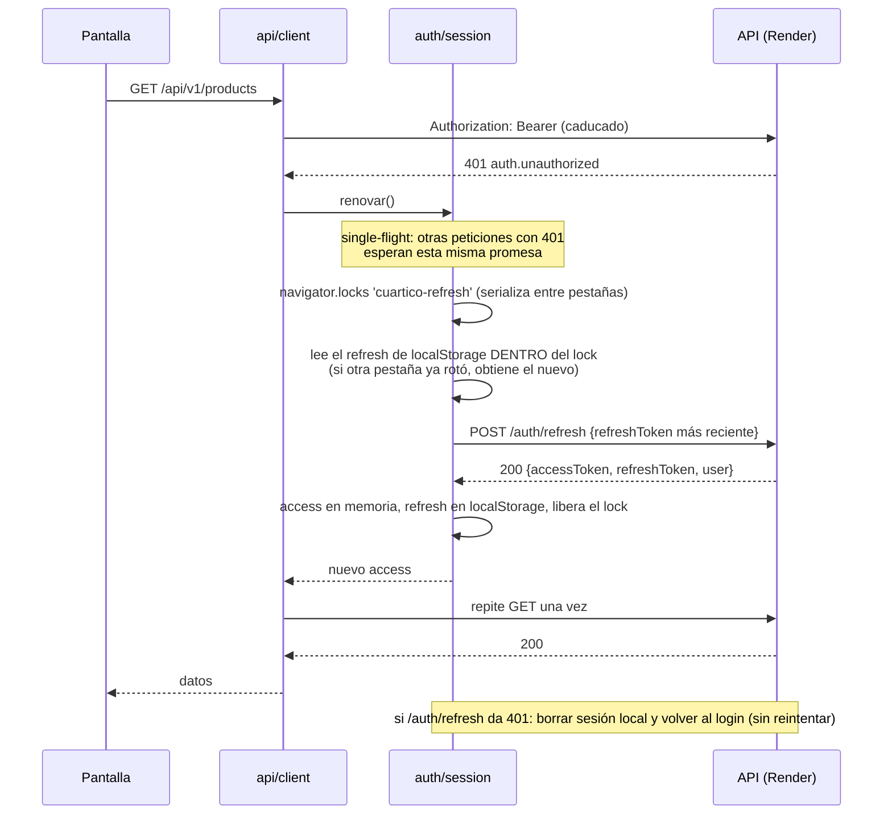
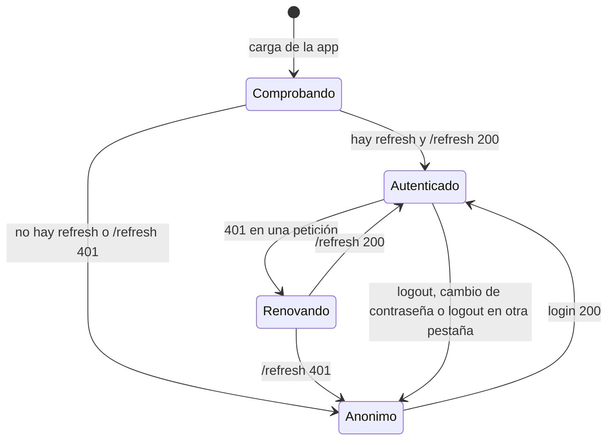

# Sesión en `cuartico-web`

Ver [HU-01](../stories/HU-01-panel-access.md) y [ADR-001](../adr/ADR-001-frontend-token-storage.md).

## Renovación ante 401 (una pestaña, varias peticiones)

## Estados de la sesión en el frontend

