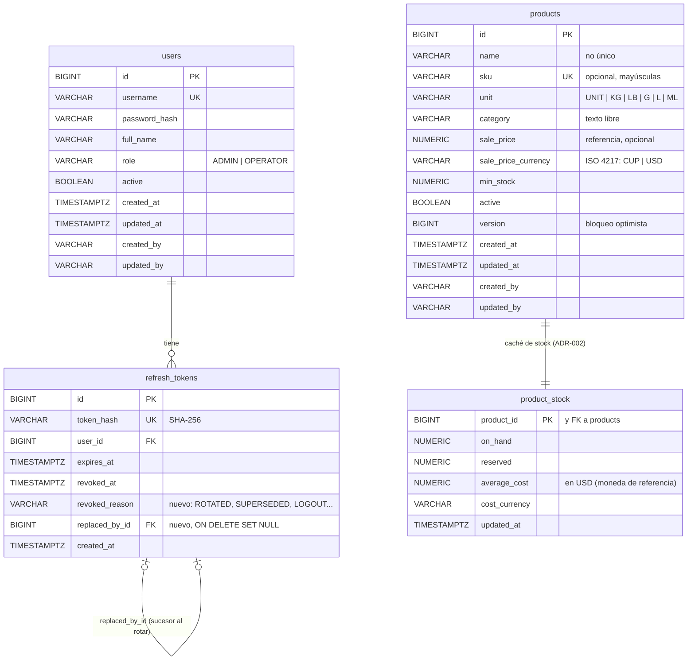
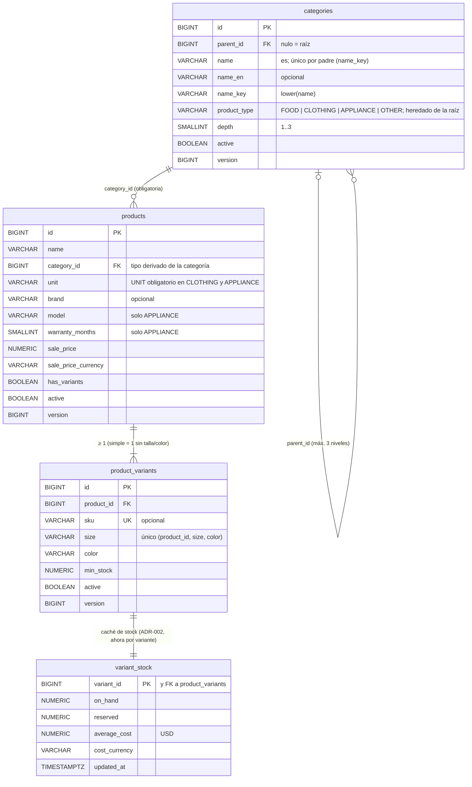

# Modelo entidad-relación

Estado propuesto al cerrar el sprint 1: V1 + productos ([HU-02](../stories/HU-02-products.md)) + ventana de gracia del
refresh ([HU-01](../stories/HU-01-panel-access.md) CA-28 a CA-33). Se amplía con cada historia.

Notas: `refresh_tokens` y `product_stock` no extienden `AuditableEntity` (no las edita un usuario). Índices: los `UK`
(`username`, `token_hash`, `sku`), `idx_refresh_tokens_user` e `idx_refresh_tokens_replaced_by` (nuevo); productos no lleva índices de búsqueda (ver HU-02, migración).

## Propuesta ADR-003 (no implementada)

> **Aceptado, aún no implementado**: [ADR-003](../adr/ADR-003-categories-types-variants.md) (2026-11-09), se
> implementa en HU-15 (V4) y HU-16 (V5). Incluye la 4.ª raíz «Aseo y hogar» (`OTHER`). Sustituye
> `products.category` (texto) por `categories` (árbol) y `product_stock` por `variant_stock` (1:1 con la variante).
> Se quitan de `products`: `category`, `sku`, `min_stock` (pasan a categoría y variante).

Futuro (HU-04/HU-06, referencia): `stock_movements.variant_id` y líneas de compra/pedido con `variant_id`;
`combo_items (product_id, variant_id nulo = «se elige al vender»)`. Columnas de auditoría omitidas en el diagrama.
