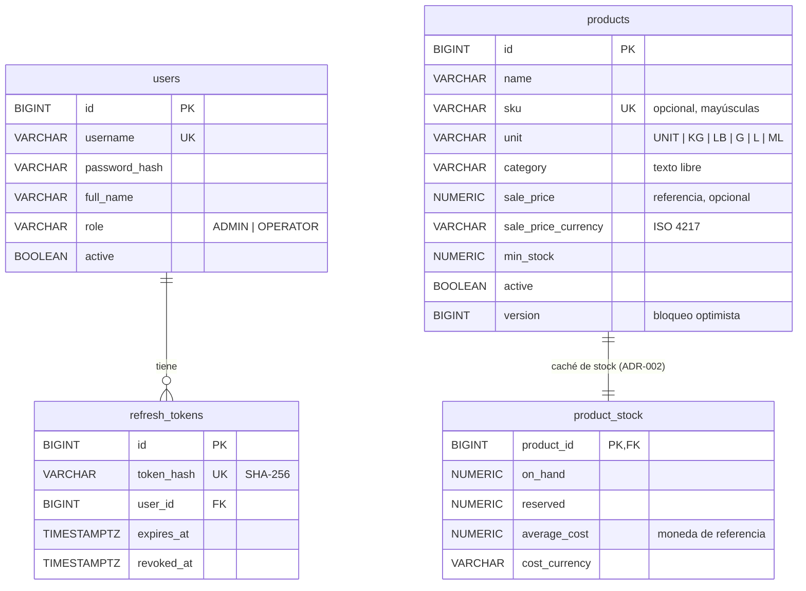

# Modelo entidad-relación

Estado tras V2 (propuesta de [HU-02](../stories/HU-02-products.md)). Se amplía con cada historia.

Las tablas de negocio llevan además `created_at`, `updated_at`, `created_by`, `updated_by` (`AuditableEntity`).
