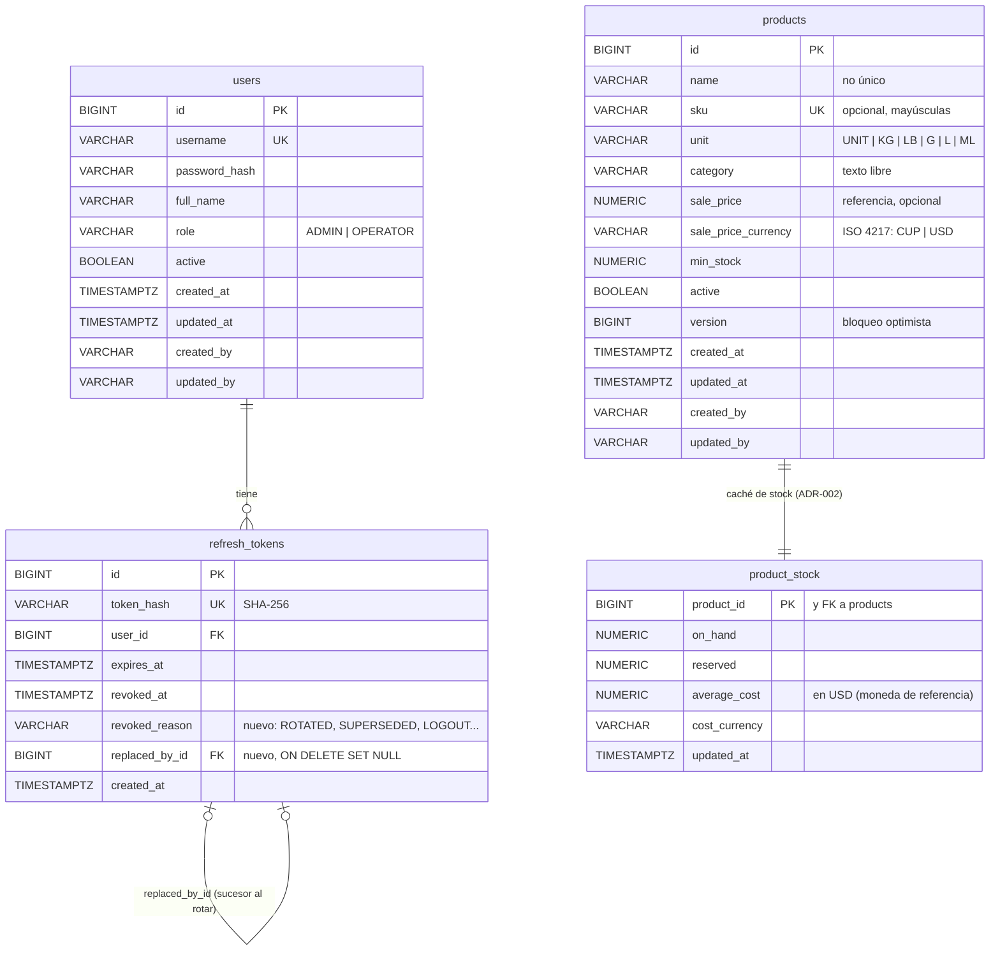

# Modelo entidad-relación

Estado propuesto al cerrar el sprint 1: V1 + productos ([HU-02](../stories/HU-02-products.md)) + ventana de gracia del
refresh ([HU-01](../stories/HU-01-panel-access.md) CA-28 a CA-33). Se amplía con cada historia.

Notas: `refresh_tokens` y `product_stock` no extienden `AuditableEntity` (no las edita un usuario). Índices: los `UK`
(`username`, `token_hash`, `sku`), `idx_refresh_tokens_user` e `idx_refresh_tokens_replaced_by` (nuevo); productos no lleva índices de búsqueda (ver HU-02, migración).
